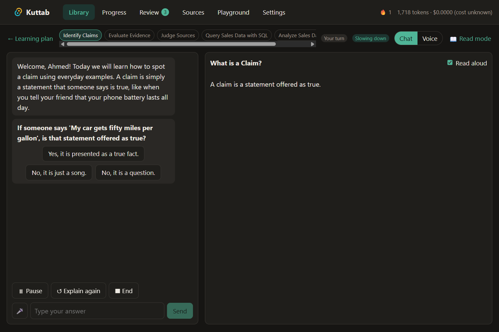
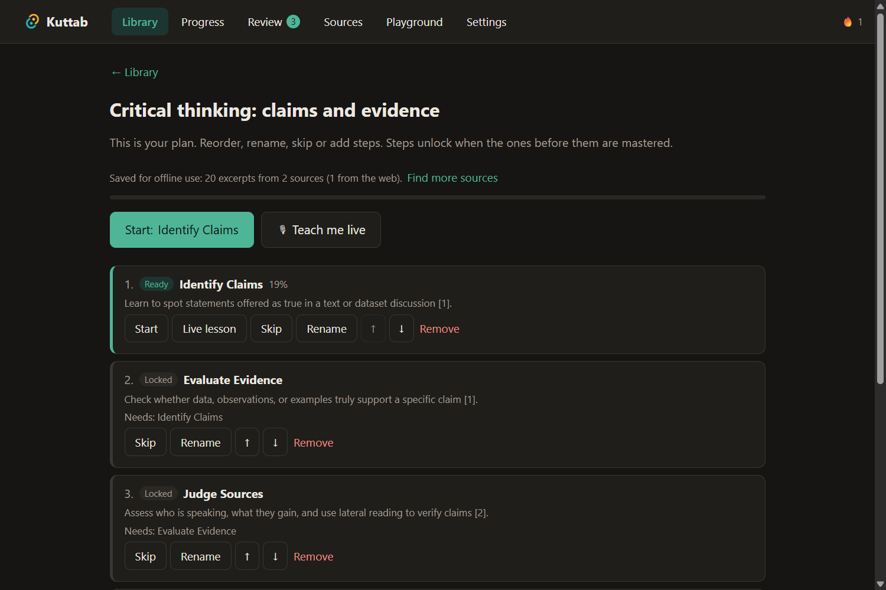
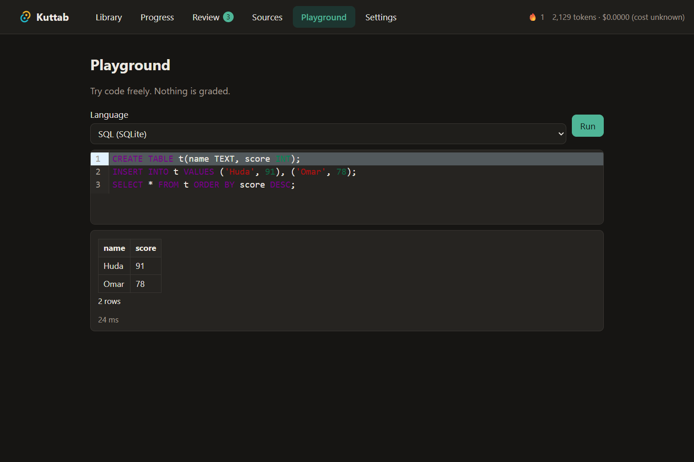
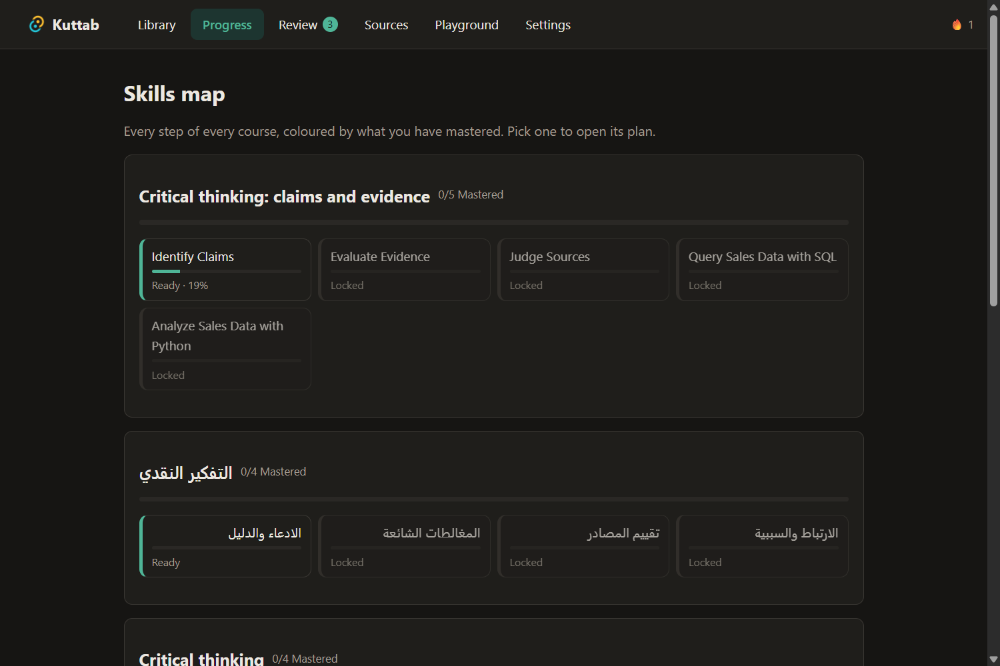
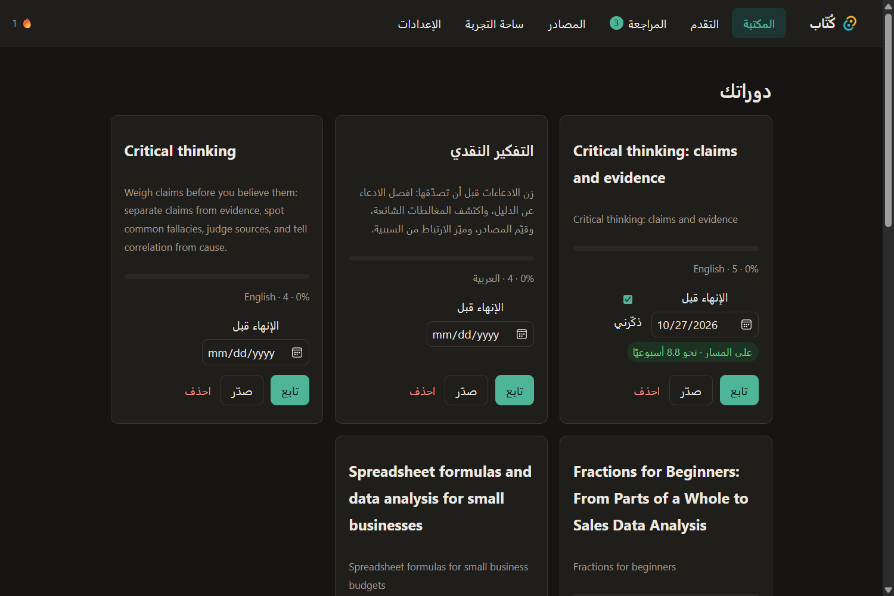
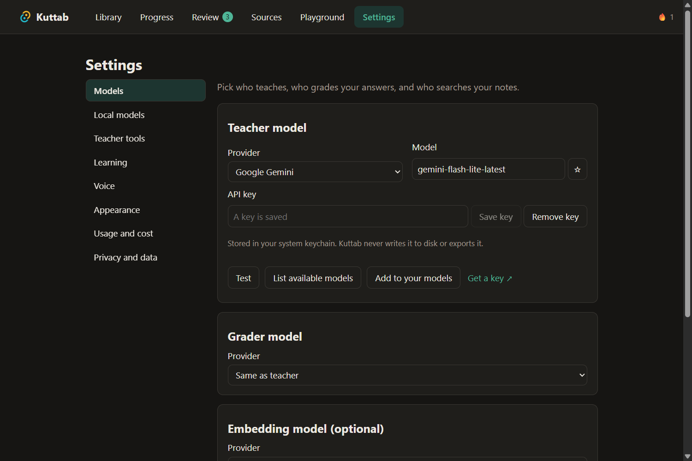

<div dir="rtl">

<div align="center">

# كُتّاب · Kuttab

[English](README.md) · **العربية**

**معلّم خصوصي بالذكاء الاصطناعي يعمل على حاسوبك.**
يعلّمك أي موضوع: يضع خطة الدورة، ويشرحها لك مباشرة، ويشغّل معامل برمجة حقيقية، ويتذكّر طريقتك في التعلّم.
يعمل مع النموذج الذي تختاره، سحابيًا كان أو محليًا. لا حساب، ولا خادم، ولا جمع بيانات.

[](https://github.com/ahmadmhmdsy/kuttab/actions/workflows/app.yml)
[](LICENSE)




</div>

> الاسم مأخوذ من «الكُتّاب»، مدارس الحيّ التي تعلّم فيها الأطفال القراءة
> وإلى جانب كلٍّ منهم معلّم. يريد كُتّاب أن يمنح كل متعلّم ذلك المعلّم.

## لماذا كُتّاب

- **معلّمك على جهازك.** الدورات والتقدّم والملاحظات والمصادر محفوظة في قاعدة SQLite على قرصك. مفاتيح API تُحفظ في سلسلة مفاتيح النظام، ولا تُكتب في ملفات ولا تُصدَّر أبدًا.
- **أي نموذج.** استخدم مفتاحًا من OpenAI أو Anthropic أو Google Gemini أو OpenRouter أو OpenCode أو أي خدمة متوافقة مع OpenAI. أو شغّل نموذجًا محليًا عبر Ollama أو LM Studio أو llama.cpp أو ملف GGUF من Hugging Face أو WebLLM داخل المتصفح. ويمكنه أن يعمل دون اتصال بالإنترنت تمامًا.
- **العربية والإنجليزية.** الواجهة كاملة باللغتين، مع تخطيط كامل من اليمين إلى اليسار. ويتحدث الصوت بالعربية الفصحى أو بلهجة تختارها.

## ماذا يفعل

### 🎙️ معلّم مباشر
المعلّم يدير الجلسة: يشرح، ويسأل، وينتظر إجابتك، ثم يتكيّف معها.
- **الأوضاع:** محادثة نصية أو صوتية، مع الضغط للتحدث أو ميكروفون يستمع دائمًا (Silero VAD).
- **الأصوات:** أصوات مزوّدي الصوت الفوري، أو أصوات Piper التي تعمل على جهازك، أو صوت النظام.
- **السبورة:** سبورة إلى جانب المحادثة تعرض الرسوم البيانية والمخططات والمعادلات والصور المولّدة ومعامل البرمجة أثناء حديث المعلّم.
- **مظهر المعلّم:** كرة أو وجه أو شخصية صغيرة تتفاعل وهو يستمع ويفكّر ويتحدث.
- **وضع القراءة:** يحوّل أي جلسة إلى درس مكتوب، مع ملاحظات بعدها.

### 🧭 دورات على مقاسك
- **خطة الدورة:** اكتب موضوعًا، فيبحث فيه المعلّم مرة واحدة، ويبني خطة يمكنك إعادة ترتيبها أو تعديلها، ويحفظ المادة لاستخدامها دون اتصال.
- **الإيقاع:** يقدّر مستواك أثناء التعلّم فيبطئ أو يسرع، ويعيدك إلى الخطة بعد الأسئلة الجانبية.
- **ملف المتعلّم:** صفحة بعنوان *ما يعرفه المعلّم عني* يمكنك قراءتها وتعديلها.
- **الأهداف:** مواعيد إنهاء مع مؤشر للإيقاع، وتذكيرات، وخيار في شريط النظام.
- **عدة متعلّمين:** ملفات منفصلة على حاسوب واحد.



### 🧪 معامل حقيقية مع التصحيح
- **داخل التطبيق:** يعمل SQL (sql.js) وPython (Pyodide) في عمّال معزولين مع حدود زمنية.
- **التصحيح:** تُصحَّح الإجابات بالاختبارات أولًا، ثم بالنموذج الذي يشرح موضع الخطأ.
- **التدريب:** ساحة تجربة حرة، ودروس من كتل محددة (شرح، وأمثلة محلولة، وأسئلة تحقق، وتمارين، وخلاصات)، ومراجعة متباعدة بخوارزمية FSRS.

<p>
  
  
</p>

### 📚 مصادرك الخاصة
- **الاستيراد:** ملفات PDF وDOCX وMarkdown، وصفحات الويب، والصور (يقرؤها نموذج رؤية)، ونصوص الصوت والفيديو، وترجمات يوتيوب.
- **البحث:** بحث محلي، وإجابات مستندة إلى مصادرك مع الإشارة إليها.
- **البحث على الويب:** بموافقتك فقط، عبر المتصفح المدمج أو مزوّد بحث تختاره.
- **حزم الدورات:** شارك الدورات كملفات `.kuttab`. ثلاث حزم نموذجية مرفقة.

### 🧰 معلّم يستخدم أدوات
يستدعي المعلّم أدواته المدمجة حين يحتاجها: رسوم بيانية، ومخططات، ومعادلات، واختبارات قصيرة، وتشغيل الشيفرة، والبحث في المصادر، وذاكرة المتعلّم، وتوليد الصور. ويمكن إيقاف كل أداة من الإعدادات. أما النماذج التي لا تدعم الأدوات فتعمل بمحادثة عادية.

### 💸 تكاليف واضحة
- **عدّاد مباشر:** عدد الرموز والتكلفة لكل جلسة.
- **الميزانية:** حدّ للجلسة، ينقلك عند بلوغه إلى نموذجك المحلي.
- **وضع الموارد المنخفضة:** للأجهزة الصغيرة.
- **فحص العتاد:** يقترح نموذجًا محليًا يناسب حاسوبك.

<p>
  
  
</p>

## البدء

لا توجد بعد ملفات تثبيت موقّعة. للحصول على التطبيق، ابنِه من المصدر، أو نزّل نسخة غير موقّعة من قسم **Artifacts** في آخر [تشغيل لـ CI](https://github.com/ahmadmhmdsy/kuttab/actions/workflows/app.yml).

تحتاج إلى:
- Node 24
- pnpm 12
- Rust (الإصدار المستقر)
- [متطلبات Tauri 2](https://tauri.app/start/prerequisites/) لنظامك

</div>

```bash
git clone https://github.com/ahmadmhmdsy/kuttab.git
cd kuttab
pnpm install
pnpm tauri dev     # تشغيل تطبيق سطح المكتب
pnpm tauri build   # بناء ملفات التثبيت في apps/desktop/src-tauri/target/release/bundle
```

<div dir="rtl">

عند التشغيل الأول:
1. اختر نموذج المعلّم من **الإعدادات ← النماذج**: الصق مفتاحًا، أو وجّه كُتّاب إلى خادم محلي مثل Ollama.
2. اكتب موضوعًا وابدأ التعلّم.

## كيف بُني

| الجزء | وظيفته |
| --- | --- |
| `apps/desktop` | Tauri 2 مع React 19 وVite: الواجهة، والجلسة المباشرة، والسبورة، والصوت، والإعدادات. ويتولّى Rust طلبات HTTP، وقاعدة SQLite، وسلسلة المفاتيح، وشريط النظام، وفحص العتاد. |
| `packages/engine` | محرّك التعليم: الخطط، وكتل الدروس، والإتقان، ومراجعة FSRS، وحلقة الجلسة المباشرة، والإيقاع، وملف المتعلّم، وأدوات المعلّم، والبحث لبناء المسارات، والأهداف. |
| `packages/llm-gateway` | واجهة واحدة لمزوّدي النماذج السحابيين والمحليين عبر Vercel AI SDK، مع فهرس النماذج وأسعارها، واكتشاف النماذج، والتضمينات، وتوليد الصور. |
| `packages/kb` | قاعدة المعرفة المحلية: الاستخراج، والتقطيع، والبحث الهجين بالكلمات والمتجهات. |
| `packages/labs` | بيئات تشغيل SQL وPython ومصحّحاتها. |
| `packs/` | حزم دورات `.kuttab` نموذجية. |

أوامر شائعة:
- `pnpm test`: يشغّل اختبارات الوحدات (vitest).
- `pnpm typecheck`: يفحص الأنواع في كل الحزم.

يشغّل CI الأمرين عند كل دفع، ويبني ملفات تثبيت غير موقّعة لويندوز وماك ولينكس.

## الحالة

كُتّاب في مرحلة **ما قبل الإصدار**. المعلّم المباشر، والتكيّف، وبناء المسارات، والصوت، والوضع المحلي، والإضافات (الصور، ومظاهر المعلّم، والأهداف، وعدة متعلّمين) كلها تعمل. المتبقّي قبل الإصدار 1.0:
- ملفات تثبيت موقّعة
- التحديث التلقائي
- استيراد النسخ الاحتياطية

انظر [docs/01-project.md](docs/01-project.md) للمراحل، و[docs/04-tasks.md](docs/04-tasks.md) لسجل المهام (بالإنجليزية).

## المساهمة

البلاغات وطلبات الدمج مرحّب بها. وثائق المشروع (بالإنجليزية):

- [docs/01-project.md](docs/01-project.md): النطاق والمراحل
- [research/analysis.md](research/analysis.md): البحث والبنية
- [docs/03-handoff.md](docs/03-handoff.md): الحالة الحالية
- [AGENTS.md](AGENTS.md): كيف يعمل وكلاء الذكاء الاصطناعي في هذا المستودع

## الترخيص

[Apache-2.0](LICENSE) © 2026 أحمد محمود

</div>
